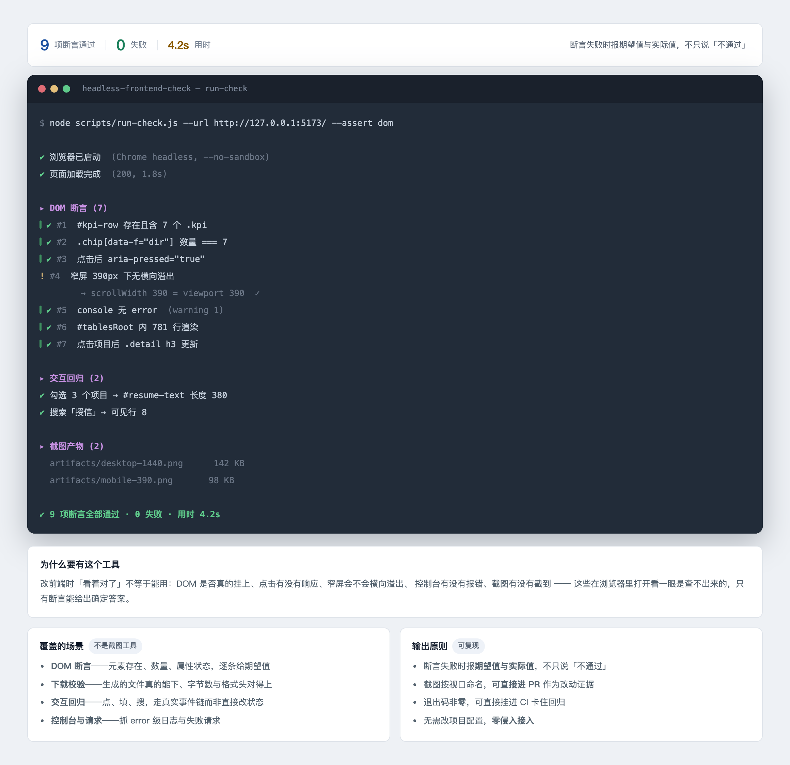

# headless-frontend-check

Verify local frontend changes **in a real browser**, straight from the terminal.

You change some HTML/JS, reload the page, squint at it, and declare it fine. Then a
button is silently disabled, a modal never opens, an export button returns 200 but
produces no file, or a typo throws an exception that only shows up in a console you
never opened.

This repo is a small set of scripts that turns that squinting into assertions.

```
$ node scripts/run-check.js http://localhost:3000
URL:        http://localhost:3000
Title:      外规条款级入库预处理
Screenshot: /var/folders/.../hfc-xxxx/screenshot.png
Body head:  "外规条款级入库预处理 上传制度文件 → 自动提取文本 → 按条款切分"

Runtime errors: none
```

## Output



*(Interface sketch — output format only; sample assertions and timings are illustrative.)*


## Why not just eyeball it

| Failure mode | Eyeballing | This repo |
|---|:--:|:--:|
| Element rendered but `display:none` | misses | `visible` assertion |
| Button stuck `disabled` | usually misses | `disabled` assertion |
| Uncaught exception in a click handler | invisible | captured (`pageerror`) |
| `console.error` / failed request | invisible | captured (`console`) |
| Export button returns 200 but no file | **misses** | `download.js` |
| Count/order regressions after a loop change | tedious | `count` assertion |

## Install

```bash
npm install
```

Needs a Chrome/Chromium binary (auto-detected, not bundled). If detection fails:

```bash
export PUPPETEER_EXECUTABLE_PATH=/path/to/chrome
```

## Usage

### 1. Smoke check + screenshot

```bash
node scripts/run-check.js http://localhost:3000 /tmp/home.png
```

Loads the page, prints the title and the first bit of body text, lists any runtime
errors, saves a full-page screenshot. Exits non-zero if there were runtime errors.

### 2. DOM assertions

Describe what should be true in a JSON file, then run it:

```bash
node scripts/assert.js ./checks/home.json
```

```json
{
  "url": "http://localhost:3000",
  "waitMs": 1200,
  "screenshot": "/tmp/home.png",
  "assertions": [
    { "type": "title",    "contains": "My App" },
    { "type": "visible",  "selector": "#drop-zone" },
    { "type": "hidden",   "selector": "#batch-bar" },
    { "type": "text",     "selector": ".file-name", "contains": "报告.docx" },
    { "type": "count",    "selector": "#jobs .job", "equals": 3 },
    { "type": "disabled", "selector": "#submit", "equals": false },
    { "type": "class",    "selector": "#modal", "has": "show" },
    { "type": "attr",     "selector": "img", "name": "src", "contains": ".png" }
  ]
}
```

Output:

```
  PASS  visible #drop-zone
  PASS  hidden #batch-bar
  FAIL  count #jobs .job  -> count=2

================ Summary ================
Passed 7/8
```

Every run also asserts no uncaught exceptions and no console errors.

### 3. Verify a download actually happens

The check that DOM assertions fundamentally cannot do:

```bash
DOWNLOAD_EXT=.zip node scripts/download.js http://localhost:3000 '#export-all'
```

Clicks the selector, waits for a file to appear in a temp directory, asserts it is
non-empty and has the expected extension.

```
  PASS  click target exists: #export-all
  (clicked #export-all, waiting for a file in /tmp/hfc-dl-xxxx)
  Downloaded: /tmp/hfc-dl-xxxx/clauses-20260902-1336.zip (1056 bytes)
  PASS  a file was downloaded
  PASS  file is not empty  -> 1056 bytes
  PASS  file extension matches .zip
  PASS  no uncaught JS exceptions
```

## Worked example: verifying a new "batch download" button

A real case this repo was extracted from. A tool gained a button that zips every
processed file server-side. Things worth asserting:

1. The toolbar is hidden before there are any results.
2. After uploading 3 files, it appears and the counter reads 3.
3. Clicking it produces a real zip whose contents have the right names.
4. The button returns from its "打包中…" state to clickable.
5. Nothing threw along the way.

Steps 1–2, 4–5 are config-driven assertions; step 3 is `download.js`. Running them
surfaced exactly one issue — a `favicon.ico` 404 that produced a console error and a
blank tab icon — which was fixed with an inline SVG favicon.

## Using it as an agent skill

`SKILL.md` is written for AI coding agents: copy this directory into your agent's
skills folder (e.g. `~/.workbuddy/skills/headless-frontend-check/`) and it will know
when to reach for these checks after making frontend changes.

## Scripts

| Script | What it does |
|---|---|
| `scripts/run-check.js` | Smoke + screenshot + runtime error report |
| `scripts/assert.js` | Config-driven DOM assertions |
| `scripts/download.js` | Click → assert a file lands |
| `scripts/lib.js` | Shared: browser detection, launch flags, error capture, assertions |

## Notes

- Exit code is non-zero when any assertion fails, so it drops into CI cleanly.
- `--no-sandbox` is passed by default (needed in containers/CI, harmless on desktop).
- Dialogs (`alert`/`confirm`) are auto-accepted and recorded, so they cannot hang a run.
- A `/favicon.ico` 404 is a common harmless console error — add an inline favicon or ignore it.

## License

MIT
